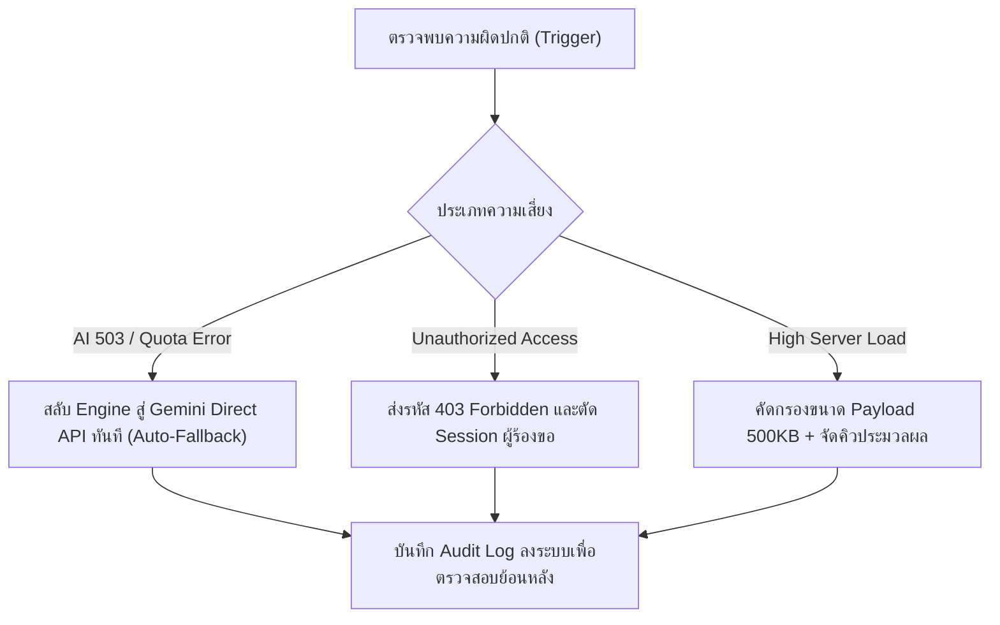

# รายงานการประมาณการงบประมาณและการประเมินความเสี่ยง
## (Comprehensive Budget Estimation & Risk Assessment Report)
### โครงการ: ProjectPilot AI — Universal Project Analyzer & Smart Budgeting Web Application

---

## 1. บทสรุปสำหรับผู้บริหาร (Executive Summary)
การพัฒนาและนำระบบ **ProjectPilot AI (Universal Project Analyzer & Smart Budgeting Agent)** ซึ่งเป็น Web Application อัจฉริยะที่ผสานการทำงานระหว่าง **Generative AI (Google Gemini 2.5 Flash / n8n Workflow)** และสถาปัตยกรรม **Fullstack React + Node.js** พร้อมระบบแยกสิทธิ์ผู้ใช้งาน (Multi-Tenant Isolation) จำเป็นต้องมีการประเมินต้นทุนทางการเงินและความเสี่ยงรอบด้าน เพื่อให้โครงการสามารถดำเนินการได้อย่างมั่นคง คุ้มค่า และมีความต่อเนื่องในการให้บริการ (Business Continuity)

---

## 2. ประมาณการงบประมาณ (Comprehensive Budget Estimation)

โครงสร้างงบประมาณถูกแบ่งออกเป็น 2 หมวดหลัก:
1. **ต้นทุนการพัฒนาและตั้งค่าเริ่มต้น (Capital Expenditure - CapEx)**
2. **ต้นทุนการดำเนินงานและบำรุงรักษารายเดือน (Operational Expenditure - OpEx)**

---

### 2.1 ต้นทุนการพัฒนาเริ่มต้น (CapEx - One-Time Development Cost)
*(กรณีจ้างทีมพัฒนาภายนอก หรือประเมินมูลค่าทรัพยากรภายในองค์กร)*

| หมวดหมู่กิจกรรม | รายละเอียดงาน | ระยะเวลา | ประมาณการงบประมาณ (บาท) |
| :--- | :--- | :---: | :---: |
| **1. System Architecture & Backend** | พัฒนา Express RESTful API, ระบบ Persistence JSON Storage, Dual-Engine Architecture (n8n + Gemini) และ Auto-Fallback | 2 สัปดาห์ | 45,000 - 65,000 |
| **2. AI Prompt Engineering & Pipeline** | ออกแบบโครงสร้าง System Instruction 5 สเต็ป (Scope, WBS, CapEx/OpEx, Risk, KPIs) และทดสอบความแม่นยำภาษาไทย | 1.5 สัปดาห์ | 35,000 - 50,000 |
| **3. Modern Frontend & Multi-device UI** | พัฒนา React 18, Vite, Responsive Mobile Bottom Nav, Dynamic Data Tables และระบบ Export (Word, Excel UTF-8, PDF) | 2 สัปดาห์ | 40,000 - 60,000 |
| **4. Multi-Tenant Auth & Security** | ติดตั้งระบบ User Isolation, PBKDF2/SHA-512 Hashing, JWT Bearer Token, Google OAuth 2.0 และ Helmet Security | 1.5 สัปดาห์ | 30,000 - 45,000 |
| **5. Testing, UAT & Documentation** | จัดทำเอกสารคู่มือ (User Manual), สไลด์พรีเซนต์, แบบประเมิน UAT 11 ข้อ, นโยบายความปลอดภัย และการทำ Automated Test | 1 สัปดาห์ | 20,000 - 30,000 |
| **รวมประมาณการ CapEx เริ่มต้น** | | **~7-8 สัปดาห์** | **170,000 - 250,000 บาท** |

> [!NOTE]
> ในโปรเจกต์ปัจจุบันนี้ **โค้ดและเอกสารทั้งหมดข้างต้นได้รับการพัฒนาและติดตั้งเสร็จสมบูรณ์ 100% แล้ว** ส่งผลให้ต้นทุนจริงในการเริ่มใช้งาน ณ ปัจจุบันมีเพียงค่าบริการคลาวด์และ API รายเดือน (OpEx) เท่านั้น

---

### 2.2 ต้นทุนการดำเนินงานรายเดือนและรายปี (OpEx - Recurring Cost)

#### 1) ค่าบริการ AI API (Google Gemini 2.5 Flash)
* **โมเดลที่ใช้งาน:** `gemini-2.5-flash` (ประสิทธิภาพสูง ต้นทุนต่ำมาก)
* **อัตราค่าบริการ:** 
  * Input: \$0.075 ต่อ 1,000,000 Tokens (~2.7 บาท)
  * Output: \$0.30 ต่อ 1,000,000 Tokens (~10.8 บาท)
* **การใช้งานต่อ 1 การวิเคราะห์โครงการ (5 Stages):**
  * Input Tokens: ~2,500 Tokens
  * Output Tokens: ~3,500 Tokens
  * **ต้นทุนเฉลี่ยต่อ 1 ครั้ง = ประมาณ 0.045 บาท (ไม่ถึง 5 สตางค์!)**
* **สมมติฐานการใช้งาน:**
  * ใช้งาน 500 โครงการ/เดือน = ~22.50 บาท/เดือน
  * ใช้งาน 2,000 โครงการ/เดือน = ~90 บาท/เดือน
  * ใช้งาน 10,000 โครงการ/เดือน = ~450 บาท/เดือน

#### 2) ค่าบริการ Cloud Hosting & Web Server
* **Render.com / Railway:**
  * **Free Tier:** 0 บาท/เดือน (มีระบบ Sleep หากไม่มีคนเข้า 15 นาที)
  * **Starter Plan (แนะนำสำหรับใช้งานจริง):** \$7/เดือน (~250 บาท/เดือน) — เซิร์ฟเวอร์ตื่น 24 ชม. แรม 512MB มี SSL HTTPS ฟรี
* **Domain Name (ชื่อเว็บไซต์เฉพาะ):**
  * โดเมน `.com` หรือ `.co.th` ประมาณ **400 - 800 บาท/ปี** (~35 - 70 บาท/เดือน)

---

### 2.3 ตารางเปรียบเทียบงบประมาณดำเนินงาน 3 ระดับ (3-Tier Operational Budget)

| รายการต้นทุน | Tier 1: MVP / PoC (ทดลองใช้) | Tier 2: Business / SME (แนะนำ) | Tier 3: Enterprise / Scaled |
| :--- | :---: | :---: | :---: |
| **กลุ่มเป้าหมาย** | ผู้ใช้ภายใน 5-10 คน | ทีมงาน/บริษัท 20-100 คน | องค์กรขนาดใหญ่ 500+ คน |
| **ปริมาณการวิเคราะห์/เดือน** | 100 - 300 ครั้ง | 1,000 - 3,000 ครั้ง | 10,000+ ครั้ง |
| **Cloud Hosting (Render/VPS)** | ฟรี (\$0) | ~250 บาท/เดือน (\$7) | ~900 - 1,800 บาท/เดือน (\$25-50) |
| **Google Gemini AI API** | ฟรี (Free Tier) หรือ ~15 บาท | ~50 - 150 บาท/เดือน | ~450 - 1,200 บาท/เดือน |
| **Database & Storage** | ในตัวเซิร์ฟเวอร์ (ฟรี) | ในตัวเซิร์ฟเวอร์ (ฟรี) | Managed PostgreSQL (~500 บาท) |
| **Domain & SSL** | ซับโดเมนฟรี (`.onrender.com`) | Custom Domain (~50 บาท/ด.) | Custom Domain + Cloudflare Pro |
| **งบสำรองฉุกเฉิน (15%)** | 0 บาท | ~70 บาท/เดือน | ~500 บาท/เดือน |
| **รวมงบประมาณรายเดือน** | **0 - 50 บาท/เดือน** | **~420 - 650 บาท/เดือน** | **~3,000 - 5,000 บาท/เดือน** |
| **งบประมาณรายปีโดยประมาณ** | **< 600 บาท/ปี** | **~5,000 - 7,800 บาท/ปี** | **~36,000 - 60,000 บาท/ปี** |

---

## 3. การประเมินและบริหารจัดการความเสี่ยง (Risk Assessment Matrix)

การบริหารความเสี่ยงวิเคราะห์ตามกรอบ **โอกาสเกิด (Likelihood)** และ **ผลกระทบ (Impact)**:

```
[ระดับความเสี่ยง] = [โอกาสเกิด: 1-5] x [ผลกระทบ: 1-5]
- ระดับ 1-6   : ความเสี่ยงต่ำ (Low)
- ระดับ 8-12  : ความเสี่ยงปานกลาง (Medium)
- ระดับ 15-25 : ความเสี่ยงสูง (High / Critical)
```

| รหัส | ปัจจัยความเสี่ยง (Risk Event) | โอกาสเกิด (1-5) | ผลกระทบ (1-5) | ระดับความเสี่ยง | มาตรการป้องกันและแก้ไข (Mitigation Strategy) |
| :---: | :--- | :---: | :---: | :---: | :--- |
| **R1** | **API Rate Limit / Quota เต็ม**<br>AI ค้างหรือไม่ตอบสนองเมื่อมีผู้ใช้งานพร้อมกันจำนวนมาก | 3 | 4 | **12 (Medium)** | • ติดตั้งระบบ **Auto-Fallback** สลับระหว่าง n8n Cloud และ Direct Gemini API อัตโนมัติ<br>• มี Exponential Backoff และแสดงแจ้งเตือนที่เข้าใจง่าย |
| **R2** | **AI Hallucination (ความคลาดเคลื่อน)**<br>AI ประมาณการตัวเลขงบประมาณหรือระยะเวลาไม่สมจริง | 2 | 4 | **8 (Medium)** | • ใช้ **Structured System Instruction** กำหนดตรรกะคำนวณ CapEx/OpEx ชัดเจน<br>• บังคับใส่ **Contingency Reserve 10-15%** เสมอ เพื่อเป็นเกราะป้องกันงบบานปลาย |
| **R3** | **งบประมาณค่า AI บานปลาย**<br>ผู้ใช้กดวิเคราะห์ซ้ำๆ หรือมีสคริปต์สแปมยิง API | 2 | 3 | **6 (Low)** | • จำกัดขนาด Input Payload ไม่เกิน 500KB<br>• กำหนดเพดาน `maxOutputTokens: 8192`<br>• สามารถเพิ่มระบบ Rate Limit ต่อ User ได้ |
| **R4** | **การรั่วไหลของข้อมูลข้ามบัญชี (Data Privacy)**<br>ผู้ใช้เห็นข้อมูลโครงการของผู้อื่น | 1 | 5 | **5 (Low)** | • ติดตั้งระบบ **Multi-Tenant User Isolation** เข้มงวด<br>• API ตรวจสอบสิทธิ์ระดับ Database (`403 Forbidden` หากเรียกข้ามบัญชี)<br>• รองรับ Google OAuth และ PBKDF2 Password Hashing |
| **R5** | **ความลับระบบรั่วไหล (API Key Leak)**<br>คีย์ Gemini หรือ n8n ถูกเปิดเผยต่อสาธารณะ | 1 | 5 | **5 (Low)** | • **Zero Client Exposure:** คีย์ถูกซ่อนอยู่ในเซิร์ฟเวอร์ Backend 100% เบราว์เซอร์ไม่เคยเห็นคีย์<br>• ตั้งค่า `.gitignore` ไม่ให้ดันไฟล์ `.env` ขึ้น Git |
| **R6** | **Server Cold Start (เซิร์ฟเวอร์หลับในโหมดฟรี)**<br>ผู้ใช้เปิดเว็บครั้งแรกใช้เวลารอโหลด 30-50 วินาที | 4 | 2 | **8 (Medium)** | • อัปเกรดเป็น Render Starter (\$7/mo) หรือใช้ Uptime Robot ยิง Ping ทุก 10 นาที<br>• มีหน้าโหลดและ UI 5-Stage Progress Tracker แสดงผลชัดเจน |

---

## 4. แผนบริหารความเสี่ยงด้านการดำเนินงาน (Contingency Action Plan)



---

## 5. การวิเคราะห์ความคุ้มค่าและผลตอบแทนการลงทุน (ROI & Payback Analysis)

### เปรียบเทียบต้นทุนการทำโครงการ (Project Briefing & Budgeting):

| ปัจจัยเปรียบเทียบ | วิธีดั้งเดิม (Manual PM / Consultant) | การใช้ ProjectPilot AI | ประหยัดได้ |
| :--- | :---: | :---: | :---: |
| **เวลาในการจัดทำ WBS & งบประมาณ** | 8 – 24 ชั่วโมง (1-3 วัน) | **15 – 30 วินาที** | **ลดเวลาลง > 98%** |
| **ต้นทุนแรงงานเฉลี่ยต่อโครงการ** | ~2,500 – 6,000 บาท/โปรเจกต์ | **~0.05 บาท/โปรเจกต์** | **ลดต้นทุน 99.9%** |
| **ความผิดพลาดตกหล่นของงบสำรอง** | สูง (มักลืมตั้งงบฉุกเฉิน) | มีระบบตั้งงบสำรอง 10-15% เสมอ | ลดความเสี่ยงงบบานปลาย |
| **การจัดรูปแบบเอกสาร (Word/Excel)** | ใช้เวลาจัดหน้า 2-4 ชั่วโมง | **ส่งออกได้ทันทีใน 1 วินาที** | ไม่ต้องจัดหน้าใหม่ |

### จุดคุ้มทุน (Break-Even Point):
* ค่าใช้จ่ายคลาวด์รายเดือนสำหรับระดับธุรกิจ = **~500 บาท/เดือน**
* เพียงแค่ระบบช่วยประหยัดเวลาของ Project Manager ในการทำเอกสารโครงการได้เพียง **1 โครงการต่อเดือน** ก็สามารถ **คืนทุนค่าใช้จ่ายรายเดือนได้ทันที (100% Breakeven ในโครงการแรก)**

---

## 6. สรุปและข้อเสนอแนะเชิงกลยุทธ์ (Strategic Recommendations)
1. **ระยะเริ่มต้น (1-3 เดือนแรก):** ดำเนินการบน **Tier 2 (งบประมาณประมาณ 450 - 650 บาท/เดือน)** บน Render.com เพื่อให้เว็บออนไลน์ 24 ชม. ไม่หลับ และใช้คีย์ Gemini 2.5 Flash
2. **การควบคุมความปลอดภัย:** รักษามาตรการ Zero Client Exposure ต่อไป และกำหนดให้ผู้ใช้งานภายในองค์กรล็อกอินผ่าน **Google OAuth** เพื่อความสะดวกและปลอดภัยสูงสุด
3. **การขยายผล:** สามารถนำระบบนี้ไปใช้เป็นเครื่องมือกลาง (Central Portal) ประจำองค์กรสำหรับคัดกรองและประเมินงบประมาณก่อนเสนอของบจริง ช่วยเพิ่มความโปร่งใสและเป็นมาตรฐานเดียวกัน
