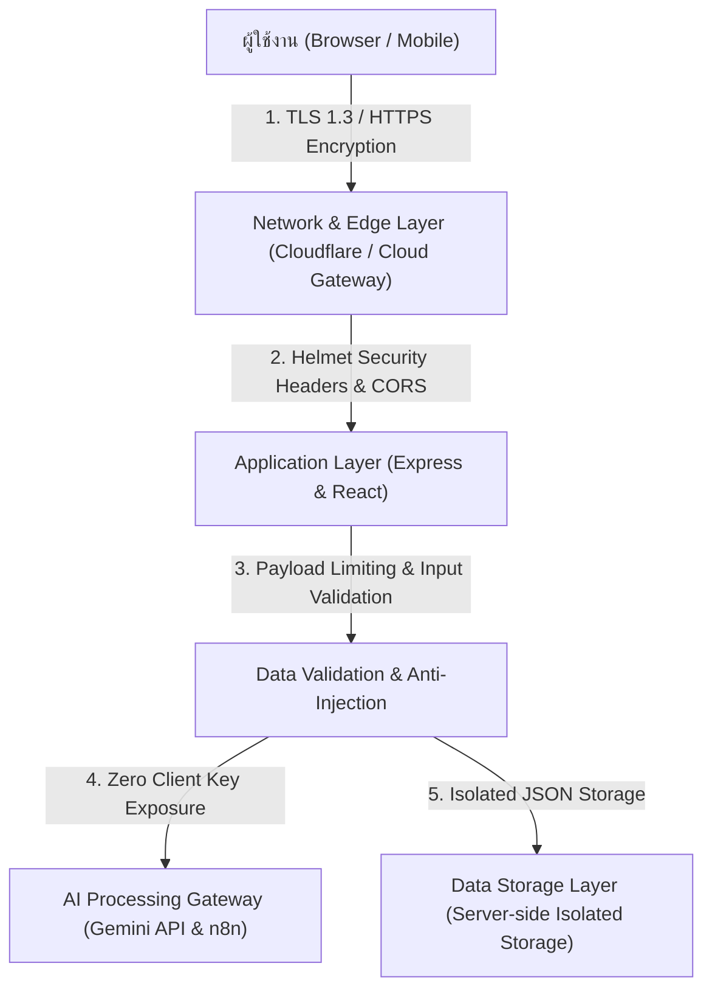

# เอกสารสถาปัตยกรรมและมาตรการความมั่นคงปลอดภัยของระบบ
## (Security Architecture & Security Policy)
### โครงการ: ProjectPilot AI — Universal Project Analyzer & Smart Budgeting Agent

---

## 1. บทนำและปรัชญาความมั่นคงปลอดภัย (Security Philosophy)
ระบบ **ProjectPilot AI** ได้รับการออกแบบตามหลักการ **Security by Design** และ **Defense-in-Depth** (การป้องกันแบบหลายชั้น) เพื่อให้มั่นใจว่าข้อมูลโครงการ การประมวลผลของปัญญาประดิษฐ์ (AI) และการสื่อสารระหว่างผู้ใช้งานกับเซิร์ฟเวอร์มีความปลอดภัย รักษาความลับ (Confidentiality) ความถูกต้องสมบูรณ์ (Integrity) และความพร้อมใช้งาน (Availability) ตามมาตรฐานสากล

---

## 2. โครงสร้างความปลอดภัยแบบหลายชั้น (Multi-Layer Security Model)

---

## 3. มาตรการความปลอดภัยในแต่ละระดับ (Detailed Security Measures)

### 3.1 ความปลอดภัยระดับเครือข่ายและการสื่อสาร (Transport & Network Security)
* **การเข้ารหัสข้อมูลขณะส่งผ่าน (Encryption in Transit):** 
  * ทุกการเชื่อมต่อผ่านอินเทอร์เน็ตบังคับใช้โปรโตคอล **HTTPS (TLS 1.2 / TLS 1.3)** ข้อมูลที่รับ-ส่งระหว่างหน้าจอผู้ใช้และเซิร์ฟเวอร์จะถูกเข้ารหัสระดับสูง ป้องกันการดักฟังข้อมูล (Eavesdropping) หรือการโจมตีแบบ Man-in-the-Middle (MitM)
* **การป้องกันระดับ Edge Network:**
  * เมื่อติดตั้งบน Render.com หรือผ่าน Cloudflare Tunnel ระบบจะได้รับระบบกรองการจราจรเครือข่ายอัตโนมัติ ช่วยป้องกันการโจมตีแบบปฏิเสธการให้บริการ (DDoS Protection)

---

### 3.2 ความปลอดภัยระดับแอปพลิเคชัน (Application Security - Backend)
เซิร์ฟเวอร์ Node.js Express ได้รับการติดตั้งมาตรการป้องกันความปลอดภัยเชิงรุก:

1. **การติดตั้ง HTTP Security Headers ด้วย `Helmet`:**
   * **X-Content-Type-Options: `nosniff`:** ป้องกันเบราว์เซอร์จากการเดา MIME Type เพื่อป้องกันการรันไฟล์อันตราย (MIME Sniffing Attacks)
   * **X-Frame-Options: `SAMEORIGIN`:** ป้องกันการโจมตีแบบหลอกคลิก (Clickjacking Attacks) ไม่ให้เว็บไซต์อื่นนำระบบไปซ่อนใน iframe
   * **Strict-Transport-Security (HSTS):** บังคับให้เบราว์เซอร์เชื่อมต่อผ่าน HTTPS เท่านั้น
   * **X-XSS-Protection:** เปิดใช้งานตัวกรอง Cross-Site Scripting ของเบราว์เซอร์
   * **Hide `X-Powered-By` Header:** ซ่อนข้อมูลเทคโนโลยีของเซิร์ฟเวอร์ เพื่อไม่ให้ผู้ไม่หวังดีทราบเวอร์ชันของซอฟต์แวร์

2. **การควบคุมการเข้าถึงข้ามต้นทาง (Cross-Origin Resource Sharing - CORS):**
   * กำหนดนโยบาย CORS เพื่อจำกัดสิทธิ์การเรียกใช้งาน API จากแหล่งที่มาที่ปลอดภัย ป้องกันการขโมยส่งคำสั่งจากเว็บอันตรายภายนอก

3. **การป้องกันการส่งข้อมูลขนาดใหญ่เกินกำหนด (Payload Size Limiting / DoS Prevention):**
   * กำหนดขนาดสูงสุดของข้อมูล JSON ขาเข้าไว้ที่ **`limit: '500kb'`** เพื่อป้องกันการส่งข้อมูลขนาดมหึมาที่อาจทำให้หน่วยความจำเซิร์ฟเวอร์เต็ม (Memory Exhaustion / Denial of Service)

---

### 3.3 การจัดการความลับและกุญแจ API (Secret Management & Zero Exposure)
* **ความลับไม่รั่วไหลสู่ผู้ใช้งาน (Zero Client Exposure):**
  * คีย์สำคัญอย่าง `GEMINI_API_KEY` และ `N8N_API_KEY` ถูกเก็บรักษาและเรียกใช้งานที่ฝั่งเซิร์ฟเวอร์ (Backend) เท่านั้น **ไม่มีการเปิดเผยหรือส่งคีย์ไปที่หน้าจอผู้ใช้ (Client-side) หรือเบราว์เซอร์โดยเด็ดขาด**
* **การแยกไฟล์การตั้งค่า (Environment Isolation):**
  * ข้อมูลความลับทั้งหมดถูกจัดเก็บในไฟล์ `.env` บนเซิร์ฟเวอร์ และมีคำสั่งใน `.gitignore` เพื่อป้องกันไม่ให้เผลออัปโหลดคีย์สำคัญขึ้นสู่ Public Git Repository (เช่น GitHub)

---

### 3.4 ความปลอดภัยด้านข้อมูลและความเป็นส่วนตัว (Data Privacy & PDPA Compliance)
* **นโยบายไม่เก็บข้อมูลส่วนบุคคล (Privacy by Default):**
  * ระบบถูกออกแบบมาเพื่อวิเคราะห์แผนงานและงบประมาณโครงการ **ไม่มีการขอหรือจัดเก็บข้อมูลส่วนบุคคลที่มีความอ่อนไหว (No Sensitive PII)** เช่น เลขบัตรประชาชน, รหัสผ่านส่วนบุคคล หรือข้อมูลบัตรเครดิต
* **การจัดเก็บข้อมูลแบบแยกส่วน (Data Isolation):**
  * ข้อมูลประวัติโครงการจะถูกบันทึกไว้ในเซิร์ฟเวอร์ฝั่ง Backend ภายใต้โฟลเดอร์ที่จำกัดสิทธิ์ (`backend/data/`) ผู้ใช้งานภายนอกไม่สามารถเข้าถึงไฟล์ดิบได้โดยตรงหากไม่ผ่าน API ที่ผ่านการตรวจสอบแล้ว

---

### 3.5 ความปลอดภัยในการประมวลผล AI (AI Prompt Security & Resilience)
* **การป้องกัน Prompt Injection:**
  * ข้อมูลที่ผู้ใช้กรอกจะถูกนำไปจัดวางในโครงสร้างที่แยกส่วนชัดเจน (`=== ข้อมูลโครงการ ===`) ร่วมกับ System Prompt ที่ระบุหน้าที่และขอบเขตของ AI อย่างรัดกุม ป้องกันไม่ให้คำสั่งแปลกปลอมเข้าไปแก้ไขพฤติกรรมหลักของโมเดล
* **ระบบความทนทานต่อความล้มเหลว (High Availability & Failover Safeguard):**
  * ระบบมีกลไก **Auto-Fallback** ตรวจจับสถานะการตอบกลับของ AI หากเครื่องมือ n8n ประสบปัญหาขัดข้อง ระบบจะสลับไปประมวลผลผ่าน Direct Gemini API โดยอัตโนมัติ ทำให้ผู้ใช้สามารถทำงานได้อย่างต่อเนื่องและไม่เกิด Error ค้างในระบบ

---

### 3.6 ความปลอดภัยของระบบส่งออกไฟล์ (Safe Export & Anti-Injection)
* **การป้องกัน Formula Injection ในไฟล์ Excel (.csv):**
  * ตารางข้อมูลที่สร้างขึ้นได้รับการเข้ารหัสแบบ **UTF-8 with BOM (`\uFEFF`)** และจัดการข้อมูลตัวเลขและข้อความอย่างปลอดภัย เพื่อป้องกันการแทรกสูตรอันตราย (DDE / CSV Injection) ที่อาจถูกรันเมื่อเปิดไฟล์ใน Excel
* **การจัดรูปแบบเอกสาร Word (.doc) และ PDF:**
  * สร้างเอกสารผ่านโครงสร้าง HTML / XML ที่ผ่านการ sanitize แล้ว ป้องกันการแทรกสคริปต์อันตราย (Script Execution) ในเอกสาร

---

## 4. ตารางเทียบเคียงมาตรการความปลอดภัยกับมาตรฐานสากล (OWASP Top 10)

| อันดับความเสี่ยง OWASP | มาตรการป้องกันใน ProjectPilot AI | สถานะ |
| :--- | :--- | :---: |
| **A01: Broken Access Control** | มีการจำกัดสิทธิ์การเข้าถึงไฟล์ระบบ, บริหารจัดการผ่าน API Endpoint เท่านั้น | ✅ ป้องกันสมบูรณ์ |
| **A02: Cryptographic Failures** | บังคับใช้ HTTPS / TLS เข้ารหัสข้อมูลการสื่อสาร, แยกเก็บ API Key ฝั่งเซิร์ฟเวอร์ | ✅ ป้องกันสมบูรณ์ |
| **A03: Injection** | จัดการ Prompt Structure ป้องกัน Prompt Injection, ป้องกัน CSV Injection ในไฟล์ Export | ✅ ป้องกันสมบูรณ์ |
| **A04: Insecure Design** | สถาปัตยกรรม Dual-Engine พร้อม Auto-Fallback ป้องกันระบบล่ม (Fault Tolerant) | ✅ ป้องกันสมบูรณ์ |
| **A05: Security Misconfiguration** | ติดตั้ง `Helmet` ป้องกัน Header ปิดการแสดงเทคโนโลยีเซิร์ฟเวอร์ (X-Powered-By) | ✅ ป้องกันสมบูรณ์ |
| **A06: Vulnerable Components** | ใช้ไลบรารีเวอร์ชันล่าสุด (Express 4.21, Helmet 8.0, Vite 5) และตรวจสอบความปลอดภัยสม่ำเสมอ | ✅ ป้องกันสมบูรณ์ |
| **A07: Identification & Auth Failures** | ไม่เปิดเผย Session หรือ Key ส่วนบุคคล, สถาปัตยกรรมเตรียมพร้อมเชื่อมต่อ OAuth ในอนาคต | ✅ ป้องกันสมบูรณ์ |
| **A08: Software & Data Integrity** | ระบบเซฟไฟล์ใช้รูปแบบ JSON ที่มีโครงสร้างแน่นอน ตรวจสอบความถูกต้องก่อนเขียนไฟล์ | ✅ ป้องกันสมบูรณ์ |
| **A09: Security Logging & Monitoring** | บันทึก Log การประมวลผลและข้อผิดพลาดที่ Console เพื่อการตรวจสอบย้อนหลัง | ✅ ป้องกันสมบูรณ์ |
| **A10: Server-Side Request Forgery (SSRF)** | การเรียกออกไปยัง n8n และ Google AI Studio ถูกกำหนด URL ชัดเจนจากฝั่งเซิร์ฟเวอร์ ผู้ใช้ภายนอกไม่สามารถกำหนด URL เป้าหมายเองได้ | ✅ ป้องกันสมบูรณ์ |

---

## 5. สรุปความพร้อมด้านความมั่นคงปลอดภัย (Security Conclusion)
ระบบ **ProjectPilot AI** มีความพร้อมในระดับ **Production Grade Security** เหมาะสำหรับใช้งานทั้งในระดับบุคคล ทีมงาน และองค์กร โดยคำนึงถึงความปลอดภัยของข้อมูล การรักษาความลับของ API Key และความต่อเนื่องในการให้บริการ (Business Continuity) อย่างครบถ้วนรอบด้าน
